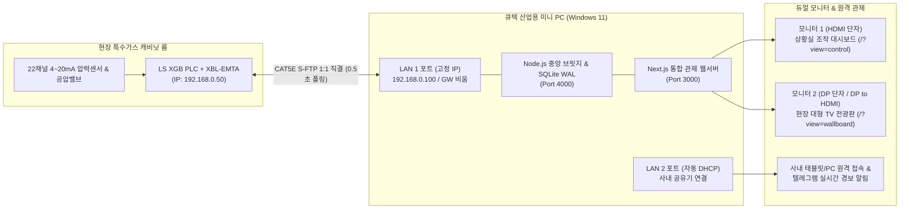

# 🛡️ ACSC 22채널 특수가스 스마트 관제 및 11뱅크 Smart AI 자동 절체 시스템

> **LS ELECTRIC XGB PLC (`XBL-EMTA`) & 큐텍(QOOTEC) 듀얼랜·듀얼모니터 산업용 PC 완벽 연동 엔터프라이즈 패키지**  
> 반도체·디스플레이·클린룸 특수가스 공급 라인의 **22채널 실시간 압력 감시**, **11뱅크(A/B 매니폴드) Smart AI 자동 절체**, **4~20mA 센서 고장(`SENSOR_FAULT`) 자가 진단**, **배관 기밀 시험(Leak Test)** 및 **법정 안전점검 보고서(A4/CSV)**를 하나로 통합한 올인원 관제 솔루션입니다.

---

## 🌐 실시간 라이브 데모 (의뢰자 시연용 Vercel 배포 주소)

별도의 PLC 장비 연결 없이도 웹 브라우저에서 **실시간 가스 소모 시뮬레이션, 22번 채널 센서 자가 진단, 11뱅크 Smart AI 제어, 기밀 시험, A4 결재 보고서**를 즉시 체험하실 수 있습니다.

| 구분 | 접속 URL | 설명 |
| :--- | :--- | :--- |
| **🖥️ 모니터 1 (상황실 통합 조작 뷰)** | **[https://22ch-plc.vercel.app/?view=control](https://22ch-plc.vercel.app/?view=control)** | 6대 메인 탭, 원격 밸브 개폐, 영점 보정, Smart AI 설정, 3대 이력 로그 통합 관제 화면 |
| **📺 모니터 2 (현장 대형 TV 전광판 뷰)** | **[https://22ch-plc.vercel.app/?view=wallboard](https://22ch-plc.vercel.app/?view=wallboard)** | 상단 탭을 자동 숨긴 전체화면 원거리 초대형 숫자판 & 위험/센서고장 스포트라이트 화면 |
| **🔑 관리자 PIN 번호** | **`1234`** | 상단 `[🔒 관리자 PIN 잠금]` 클릭 후 `1234` 입력 시 5분(300초)간 조작 잠금 해제 |

---

## 🏗️ 1. 하드웨어 환경 및 시스템 아키텍처

### 1-1. PLC 및 통신 모듈 사양
* **제어기**: LS ELECTRIC **XGB 시리즈 PLC** + **`XBL-EMTA`** (FEnet 이더넷 통신 모듈)
* **통신 케이블**: CAT5E S-FTP 차폐 랜선 (Auto Crossover 지원, 허브 없이 PC와 최대 100m 1:1 직결 지원)
* **지원 프로토콜**:
  1. **Modbus TCP** (`Port 502` / 시뮬레이터 `Port 8502`, Unit ID `1`)
  2. **LS XGT 전용 프로토콜** (`Port 2004`, 연속 바이트 읽기 `0x0054` / 단일 워드 쓰기 `0x0058` 네이티브 드라이버 내장)

### 1-2. PLC 메모리 맵 (22채널 / 11뱅크 기준)
| 구분 | PLC 디바이스 영역 | Modbus Holding Register Offset | 데이터 스케일 및 제어 규격 |
| :--- | :--- | :--- | :--- |
| **22채널 압력 읽기** | `%MW100 ~ %MW121` (`%MB200`, 44B) | Offset `0 ~ 21` (22 Words) | `실제 압력(bar) × 10` (예: `1200` = `120.0 bar`) |
| **22채널 밸브 제어 (R/W)** | `%MW200 ~ %MW221` | Offset `100 ~ 121` (22 Words) | `0`: **OPEN (밸브 개방)** / `1`: **SHUTOFF (밸브 차단)** |

---

## 🔌 2. 큐텍(QOOTEC) 산업용 미니 PC 결선 가이드 (`2 LAN` & `HDMI + DP`)

본 시스템은 팬리스 무소음 산업용 미니 PC의 **듀얼 랜 포트(`2 LAN`)**와 **듀얼 모니터 출력(`HDMI + DP`)**에 최적화되어 설계되었습니다.



### 2-1. 듀얼 랜선 연결 (`2 LAN`)
1. **`LAN 1` (PLC 1:1 직결 전용망)**:
   * LS PLC `XBL-EMTA` 모듈과 CAT5E 이상 랜선으로 1:1 직결합니다.
   * **PC 고정 IP**: `192.168.0.100` / **서브넷 마스크**: `255.255.255.0` / **기본 게이트웨이**: **비움(공란)** *(루트 폴더의 `set-plc-ip.bat` 관리자 실행 시 원클릭 설정)*
   * **PLC IP**: `192.168.0.50`
2. **`LAN 2` (사내 공유기 연결망)**:
   * 사내 유무선 공유기에 연결하여 **자동 IP(DHCP)**를 할당받습니다.
   * 텔레그램 실시간 푸시 알림 발송 및 사무실 PC·태블릿 원격 웹 접속(`http://[사내망IP]:3000`) 용도로 동작합니다.

### 2-2. 듀얼 모니터 연결 (`HDMI + DP`)
1. **`HDMI 단자` (1번 주 모니터)**:
   * 상황실 데스크 모니터 연결 (`http://localhost:3000/?view=control`, `--window-position=0,0`)
2. **`DP(DisplayPort) 단자` (2번 대형 TV 전광판)**:
   * 현장 벽걸이 대형 TV 연결 (`http://localhost:3000/?view=wallboard`, `--window-position=1920,0`)
   * TV에 DP 포트가 없는 경우 시중의 **`DP to HDMI 변환 케이블(어댑터)`**을 사용하면 완벽히 호환됩니다.

### 2-3. `XBL-EMTA` 전면 LED 상태 진단표
| LED 명칭 | 색상 | 정상 상태 | 이상 상태 | 의미 및 현장 점검 가이드 |
| :---: | :---: | :---: | :---: | :--- |
| **RUN** | 녹색 | 🟢 **점등 (켜짐)** | ⚫ 소등 | 모듈 전원 및 하드웨어 정상 가동 (소등 시 PLC 전원/장착 확인) |
| **I/F** | 녹색 | ✨ **녹색 점멸** | 점등 고정 / 소등 | PLC CPU와 통신 모듈 간 내부 인터페이스 정상 통신 중 |
| **ERR** | 적색 | ⚫ **소등 (꺼짐)** | 🔴 점멸 / 점등 | IP 충돌 또는 하드웨어 이상 (점등 시 `192.168.0.50` IP 중복 확인) |
| **TX / RX** | 녹/황색 | ⚡ **빠른 점멸** | ⚫ 계속 소등 | **0.5초 주기 실시간 패킷 송수신 중** (소등 시 PC IP 및 방화벽 확인) |
| **Link / Speed** | 녹색 | 🟢 **점등** | ⚫ 소등 | CAT5E 랜선 물리적 연결 정상 (소등 시 RJ45 커넥터/단선 점검) |

---

## ✨ 3. 핵심 엔터프라이즈 기능 명세

### 3-1. 상단 글로벌 제어 바
* **FND 4단위 원클릭 변환기 (`10번 스펙`)**: `0: PSI` ($\times 14.5$), `1: Bar` (기본), `2: MPa` ($\times 0.1$), `3: %` (잔량%) 즉시 변환
* **유지보수자 4자리 PIN 잠금 (`1234`)**: 잠금 해제 시 **5분(300초) 카운트다운** 후 자동 재잠금으로 오조작 원천 방지
* **한국어 TTS 음성안내 (`Web Speech API` + `Web Audio API`)**: 위험 저압 또는 센서 고장 발생 시 `"경고! N번 채널 수소 가스 압력이 위험 기준 이하입니다"` 한국어 음성 방송 및 경보 비프음 출력
* **`[📡 통신진단 & 하드웨어 가이드]` 모달**: 실시간 PLC 응답 지연시간(`ms`), 사내망 IP, DB 용량 확인 및 시각적 결선도/LED 진단표 제공
* **`[💾 설정 백업 / FA 복원]` (`16번 · 17번 스펙`)**:
  * **16)** 현재 채널 및 뱅크 운전 설정을 공장표준(FA) 프리셋으로 저장
  * **17)** 각 채널 센서의 고유 **영점 보정값(`calibrationOffset`)은 그대로 보존**하면서 2~15번 운전 설정만 FA 표준값으로 안전 복원

### 3-2. 6대 메인 탭 뷰
1. **🟢 22채널 그리드 (`ChannelGridTab`)**:
   * 가스 종류별 컬러 배지, FND 디지털 압력 표시, 잔량 게이지 바, 압력 강하율 기반 **실시간 소진 예상 시간(`⏳ 약 X시간 Y분 남음`)** 표시
   * 원격 밸브 개방(`OPEN`)/차단(`SHUTOFF`) 제어 및 클릭 시 **순수 SVG 최근 1분 트렌드 차트** 팝업
2. **🔀 11뱅크 A/B 매니폴드 뷰 (`BankManifoldTab`)**:
   * 좌우 A/B 실린더 및 중앙 POU 공급 라인 애니메이션 화살표 표시
   * **4대 운전 모드**: `0: Auto`(고정 `MX`초 지연), `1: Smart AI`($\Delta P/\Delta t$ 기반 최적 지연시간 `computedAiN` 실시간 산출), `2: Dual`(양쪽 동시 개방), `3: Moni`(제어 안 함)
   * `RUN Time (4.0~6.0s)`, `MX / AI N초`, `출력전압 (12.0~15.0V)` **0.1 단위 정밀 조절**
   * 주 실린더 주의 압력 이하 시 예비 실린더가 비어 있으면 **`⚠️ 예비통 빈 상태 (STANDBY_EMPTY_WARN)`** 사전 경고 발생
3. **🧪 기밀/누출 시험 (`LeakTestTab`)**:
   * `30초 / 60초 / 3분(180초)` 동안 미세 압력 강하량($\Delta P$)을 실시간 계측하여 허용 기준(`0.2 bar` 이하) 만족 여부에 따라 **`PASS` / `FAIL` 자동 판정** 및 성적서 영구 기록
4. **📺 대형 전광판 TV 뷰 (`WallboardView`)**:
   * 2번 모니터용 원거리 초대형 숫자판 그리드 및 위험/센서고장 채널 **상단 중앙 스포트라이트 확대 표시**
5. **🗺️ 공장 도면 뷰 (`FloorplanTab`)**:
   * 클린룸/가스실 기본 SVG 설계도면(또는 사용자 도면 이미지 업로드) 위에 마우스 드래그 앤 드롭으로 22채널 핀을 배치하고 전 관제 PC/태블릿에 실시간 동기화
6. **⏪ 과거 이력 & 📄 PDF 보고서 (`HistoryReportTab`)**:
   * SQLite 타임머신 슬라이더로 과거 5초 단위 스냅샷 되감기 및 **결재란(담당/검토/승인) 포함 A4 인쇄용(`window.print()`) 일간/주간 안전점검 보고서** 출력

### 3-3. 4~20mA 센서 자가 진단 (`SENSOR_FAULT`) & 0점(Zero) 정밀 보정
* **센서 고장 분리 감지**: 단선(`< 0 bar`), 측정 한계 115% 초과 노이즈 스파이크(`195.0 bar`), 0.5초 내 `45 bar` 이상 비정상 급락 발생 시 일반 저압 경보와 분리된 보라색 **`⚡ SENSOR_FAULT`**로 판정하여 **밸브 오차단 및 오절체를 방지**합니다.
* **영점 보정**: 채널 설정(`⚙️`) 모달에서 `±0.1 bar` 미세 오프셋 조절 및 **2차 안전 확인 팝업을 거치는 `[🎯 가스가 없을 때 0점(Zero) 설정]`** 기능을 제공합니다.

### 3-4. SQLite WAL 5대 테이블 & 무중단 백업 스케줄러
* `logs/acsc_history.db` (WAL 고성능 모드):
  1. `system_settings`: 22채널 설정, 11뱅크 설정, FA 프리셋, 도면 배경, 관리자 PIN 중앙 동기화
  2. `channel_logs`: 5초 주기 22채널 압력/밸브 상태 기록 + 일자별 CSV(`logs/acsc_22ch_YYYY-MM-DD.csv`, UTF-8 BOM) 자동 생성
  3. `audit_logs`: PIN 해제, 밸브 수동 제어, 영점 보정, FA 복원, Smart AI 자동 절체 감사 로그(Audit Trail) 영구 보존
  4. `cylinder_replacements`: 저압(`<= 45 bar`) → 고압(`>= 90 bar`, 상승폭 `+60 bar` 이상) 상승 시 실린더 교체 자동 감지 및 **당월 가스별 소모량 자동 집계**
  5. `leak_test_logs`: 배관 기밀 시험(`PASS`/`FAIL`) 공식 성적서 영구 기록
* **자동 유지보수**: 24시간 주기 SQLite 무중단 온라인 백업(`db.backup()`) 및 30일 경과 CSV 로그 자동 `.gz` 압축

---

## 🚀 4. 설치 및 실행 가이드 (개발 환경 & 현장 산업용 PC)

### 4-1. 패키지 설치 및 시뮬레이션 통합 구동
```bash
# 1. 저장소 클론 및 폴더 이동
git clone https://github.com/ic4u2u/22ch-PLC.git
cd 22ch-PLC

# 2. 필수 패키지 설치
npm install

# 3. 가상 PLC(Port 8502) + 중앙 브릿지 서버(Port 4000) + 웹 대시보드(Port 3000) 동시 기동
npm run dev:all
```

* 개별 실행이 필요한 경우:
  * `npm run sim:plc` : 22채널 가상 Modbus TCP PLC 서버 구동 (`127.0.0.1:8502`, 홀수 채널 가스 소모/리필 & CH22 20초 주기 `SENSOR_FAULT` 시뮬레이션)
  * `npm run sim:bridge` : 중앙 브릿지 서버 구동 (`Port 4000`, WebSocket + REST API + SQLite WAL)
  * `npm run dev` : Next.js 프론트엔드 관제 서버 구동 (`Port 3000`)

### 4-2. 현장 산업용 PC 원클릭 자동화 스크립트 4종 (루트 폴더)
현장 납품 시 루트 폴더에 포함된 4종의 배치 스크립트로 네트워크 설정부터 듀얼 모니터 Kiosk 부팅까지 원클릭으로 완료할 수 있습니다.

1. **`set-plc-ip.bat`** *(관리자 권한 실행)*:
   * 윈도우 `이더넷` 어댑터(LAN 1)에 PLC 직결용 고정 IP(`192.168.0.100`, 서브넷 `255.255.255.0`, 게이트웨이 없음) 자동 설정 및 PLC(`192.168.0.50`) Ping 테스트 수행
2. **`allow-firewall.bat`** *(관리자 권한 실행)*:
   * 사내망 태블릿/PC 원격 접속 및 PLC 통신을 위한 TCP 포트(`3000, 4000, 502, 2004, 8502`) 윈도우 방화벽 일괄 허용 및 현재 사내망 IP 안내
3. **`ecosystem.config.js`**:
   * PM2 무중단 백그라운드 서비스 설정 파일 (`PLC_IP: "192.168.0.50"`, `PLC_PROTOCOL: "MODBUS"` 또는 `"XGT"`)
4. **`start-dual-kiosk.bat`**:
   * 부팅 시 PM2 서비스 기동 후, **1번 모니터(`0,0`)에는 조작 대시보드(`/?view=control`)**, **2번 모니터(`1920,0`)에는 대형 전광판(`/?view=wallboard`)**을 각각 전체화면 Kiosk 모드로 자동 분리 실행

---

## 📁 5. 프로젝트 디렉토리 구조

```text
├── db/
│   └── migrations/
│       └── 001_init_acsc_schema.sql      # SQLite 5대 테이블 초기 마이그레이션 스키마
├── server/
│   ├── mock-plc.js                       # [파일 1] 22채널 가스 소모 & CH22 센서고장 가상 Modbus PLC (Port 8502)
│   ├── ls-xgt-client.js                  # [파일 2] 순수 net.Socket 기반 LS XGT 전용 프로토콜 드라이버 (Port 2004)
│   ├── plc-ws-bridge.js                  # [파일 3] 중앙 브릿지 서버 (0.5초 폴링 + WebSocket + REST API, Port 4000)
│   └── lib/
│       ├── db.js                         # SQLite WAL 데이터베이스 초기화 및 설정/감사로그 헬퍼
│       ├── smart-ai-engine.js            # 11뱅크 Smart AI 스위칭 엔진 & 4~20mA SENSOR_FAULT 자가 진단
│       └── backup-logger.js              # 5초 주기 CSV(UTF-8 BOM) 로거, 텔레그램 알림, 24h DB 무중단 백업
├── src/
│   ├── app/
│   │   ├── globals.css                   # Tailwind CSS & A4 인쇄(@media print) 전용 스타일
│   │   ├── layout.tsx                    # 루트 레이아웃 및 메타데이터
│   │   └── page.tsx                      # 메인 엔트리 페이지
│   └── components/
│       ├── Dashboard24.tsx               # [파일 4] 올인원 엔터프라이즈 대시보드 메인 컨테이너
│       └── dashboard/
│           ├── types.ts                  # 공통 인터페이스, 4단위 변환기, 한국어 TTS/비프음, UTF-8 BOM CSV 유틸
│           ├── mockPreset.ts             # 오프라인/클라우드 시연용 22채널·11뱅크 프리셋 데이터
│           ├── HeaderBar.tsx             # 상단 제어 바 (단위변환, PIN 잠금, TTS, 하드웨어 가이드, FA 복원)
│           ├── HardwareGuideModal.tsx    # [보완] 2 LAN 결선도 · HDMI+DP 모니터 연결도 · XBL-EMTA LED 진단표 모달
│           ├── SystemModals.tsx          # PIN 인증, 모바일 주소, FA 저장(16)/복원(17), SVG 트렌드 & 0점 보정 모달
│           ├── ChannelGridTab.tsx        # [탭 1] 🟢 22채널 그리드 뷰
│           ├── BankManifoldTab.tsx       # [탭 2] 🔀 11뱅크 A/B 매니폴드 뷰
│           ├── LeakTestTab.tsx           # [탭 3] 🧪 배관 기밀/누출 시험 뷰
│           ├── WallboardView.tsx         # [탭 4] 📺 대형 전광판 TV 뷰 (?view=wallboard 연동)
│           ├── FloorplanTab.tsx          # [탭 5] 🗺️ 공장 도면 드래그 앤 드롭 핀 뷰
│           ├── HistoryReportTab.tsx      # [탭 6] ⏪ 과거 이력 타임머신 & 📄 결재란 포함 A4 보고서 뷰
│           └── BottomLogsSection.tsx     # 하단 3대 이력 테이블 (알람 / 실린더 교체 집계 / 감사 로그) & CSV 다운로드
├── ecosystem.config.js                   # [스크립트 1] PM2 백그라운드 무중단 서비스 설정
├── start-dual-kiosk.bat                  # [스크립트 2] 듀얼 모니터(0,0 / 1920,0) 전체화면 Kiosk 자동 실행기
├── allow-firewall.bat                    # [스크립트 3] 사내망 원격 접속용 TCP 포트 방화벽 일괄 허용
└── set-plc-ip.bat                        # [스크립트 4] LAN 1 포트 PLC 1:1 직결 고정 IP(192.168.0.100) 원클릭 설정
```
